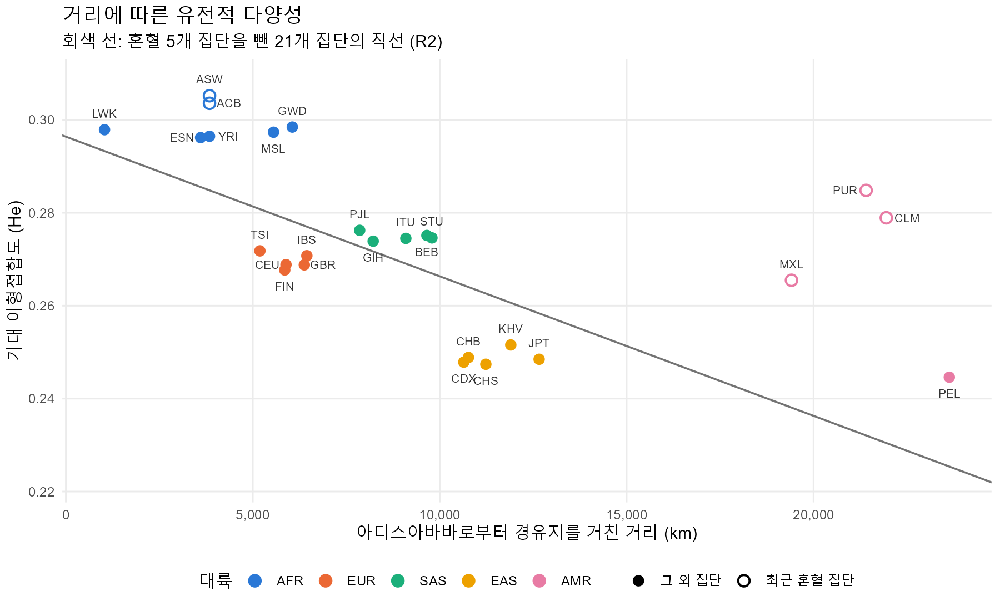

# 1000 Genomes 22번 염색체로 검증하는 연쇄 창시자 효과

**질문:** 인류 집단의 유전적 다양성은 동아프리카에서 멀어질수록 줄어드는가?

- 혼혈 5개 집단을 뺀 21개 집단에서 동아프리카로부터의 이동 거리는 기대 이형접합도(He) 차이의 **57.5%**를 설명했다 (1,000km당 He −0.0030, p = 7×10⁻⁵).
- LD decay에서도 같은 순서가 나왔다. He가 높은 집단일수록 LD가 빨리 끊겼다 (반감 거리 YRI 6.2kb → PEL 12.2kb, 다섯 집단 순서가 He 순서와 정확히 반대).
- 친척 제외, MAF 기준, LD pruning, 이상 SNP 제외를 하나씩 바꿔도 기울기의 부호는 유지됐다. 다만 R²는 0.42~0.58, 아프리카와 나머지의 He 차이는 조건에 따라 절반 아래로 줄기도 했다.

---

## 가설: 연쇄 창시자 효과

인류가 아프리카를 떠나 이동할 때 매번 원래 집단의 일부만 새 지역으로 떠났다면, 떠난 무리는 원래 변이의 일부만 가져간다. 이런 병목이 이주 경로를 따라 반복되면 아프리카에서 멀어질수록 다양성은 줄고, 염색체 조각의 종류가 줄어 LD는 길게 남는다.

이 분석은 이 가설을 **증명**하지 않는다. 가설이 예측하는 패턴이 공개 데이터에서 재현되는지, 그리고 그 결과가 전처리 선택에 얼마나 민감한지를 확인한다.

## 데이터와 기준

- **데이터:** 1000 Genomes Phase 3 (release 20130502), 22번 염색체 VCF (`v5b`), 26개 집단 2,504명
- **변이:** 1,103,547개 → 이중대립 SNP 1,055,452개 (indel, 다중대립, 구조변이 제외)
- **기준 데이터 B:** 친척 13명 제외(KING 친족계수 0.177 이상), MAF 0.05, LD pruning(`--indep-pairwise 50 5 0.2`) → **2,491명, SNP 8,551개**
- **도구:** PLINK 2.0 (b1.3), R 4.4 (tidyverse, ape, geosphere)

| 비교용 데이터 | 바꾼 조건 | SNP 수 |
|---|---|---|
| V1 | 친척 포함 | 8,582 |
| V2 | MAF 0.01 | 31,773 |
| V3 | LD pruning 생략 | 97,088 |
| V4 | MAF 0.01 + pruning 생략 | 171,629 |
| V5 | 이형접합이 비정상적으로 많은 SNP 294개 제외 | 8,257 |

### 판단 1. 집단 좌표는 표본을 모은 곳이 아니라 조상이 살던 곳으로 정했다

He는 조상 집단이 겪은 이주와 병목의 결과이므로 조상 지역이 기준이다. 예를 들어 CEU(유타 거주 북서유럽계)는 브뤼셀, GIH(휴스턴 거주 구자라트계)는 아마다바드로 놓았다. CEU를 유타에 놓으면 이동 거리가 5,888km에서 16,748km로 늘어 아메리카 집단 수준이 되고, 직선이 예상하는 He(0.246)는 실제 값(0.269)과 크게 어긋난다. 이동 거리는 아디스아바바에서 출발해 카이로, 이스탄불(유라시아), 아나디르와 프린스루퍼트(아메리카)를 거치는 경로로 계산했다 ([표 4](results/tables/table4_coordinates_distance.csv)).

### 판단 2. 최근 혼혈 집단 5개는 회귀에서 빼고, PEL은 포함했다

ASW, ACB(아프리카계), MXL, PUR, CLM(아메리카)은 여러 대륙 조상이 최근에 섞인 집단이다. 섞이면 He가 거리와 관계없이 올라가므로(5개 모두 두 조상의 중간값보다 높았다) 이주 거리로 설명하려는 질문에 맞지 않는다. 26개를 모두 넣으면 R²는 0.260으로 떨어진다.

PEL(페루 리마)은 혼혈이 일부 있지만 아메리카 원주민 조상이 대부분이라 포함했다. PEL을 빼면 R²는 0.674로 오히려 올라간다. PEL은 동아시아보다 약 11,000km 더 먼데 He는 비슷하기 때문이다. 그래서 결과를 R2(PEL 포함)와 R3(PEL 제외) 두 버전으로 모두 보고한다.

### 판단 3. 주 지표는 집단 He, 개인 관측 이형접합도(Ho)는 보조로 썼다

He는 집단의 대립유전자 빈도로 계산해 집단의 역사를 바로 나타낸다. Ho는 개인마다 계산되어 혼혈이나 근친 같은 개인 차이를 보는 데 썼다. 두 지표로 회귀한 결과는 거의 같았다 (R² 0.575 vs 0.585).

점검 중에 모든 집단에서 Ho가 He보다 약 0.008 높은 것을 발견했다. 원인은 대부분의 사람이 이형접합으로 나오는 SNP 294개였다 (서열이 비슷한 위치의 잘못된 매핑으로 추정, 직접 검증하지는 않음). 기준 B는 그대로 두고, 이 SNP를 뺀 V5를 비교 데이터로 추가했다.

## 결과

| 그림 | 내용 | 주요 수치 |
|---|---|---|
| [그림 1](results/figures/fig1_heterozygosity_box.png) | 집단별 다양성 | He: 아프리카 0.297 > 남아시아 0.275 > 유럽 0.270 > 동아시아 0.249 > PEL 0.245 |
| [그림 2](results/figures/fig2_distance_he.png), [잔차](results/figures/fig2b_residuals.png) | 거리와 He | R2: R² 0.575 / 아프리카 밖 16개만: R² 0.456 / 아프리카 안 5개: R² 0.03 |
| [그림 3](results/figures/fig3_pca_pc1_pc2.png) | PCA | PC1 9.2% (아프리카 vs 나머지), PC2 3.6% (동아시아 vs 유럽), PC3는 아메리카 원주민 조상 축 |
| [그림 4](results/figures/fig4_fst_heatmap.png), [계통수](results/figures/fig4_nj_tree.png) | F_ST와 NJ 계통수 | 대륙 사이 0.037(유럽–남아시아) ~ 0.174(아프리카–PEL), 대륙 안 0.003~0.007 |
| [그림 5](results/figures/fig5_wahlund.png) | 월룬드 효과 | 전체 빈도 기준 F: PEL 0.161, 동아시아 0.142 / 자기 집단 빈도 기준으로 바꾸면 0 근처 |
| [그림 7](results/figures/fig7_ld_decay.png), [확대](results/figures/fig7b_ld_decay_100kb.png) | LD decay (집단당 85명) | 반감 거리 YRI 6.2 < GIH 9.8 ≈ CEU 9.8 < CHB 11.6 < PEL 12.2 kb |

He와 LD는 계산 방법이 완전히 다른 지표인데 다섯 대표 집단의 순서가 정확히 반대로 맞았다. 병목은 변이 종류를 줄이고(He 감소) 염색체 조각의 종류도 줄이므로(LD 증가), 같은 역사를 두 지표가 함께 가리킨다.

## 전처리 선택이 결과에 미치는 영향

조건을 하나씩 바꾸기 전에 결과를 예측해 적고, 실행 후 대조했다. 판단 기준은 소수점 셋째 자리 차이가 아니라 결론이 바뀌는 수준의 차이다 ([표 6](results/tables/table6_preprocessing_compare.csv), [표 7](results/tables/table7_sensitivity_2x2.csv), [그림 6](results/figures/fig6b_he_compare.png)).

| 바꾼 조건 | 예측 | 실제 결과 | 이유 |
|---|---|---|---|
| 친척 포함 (V1) | PC1-PC2에서 친척이 눈에 띄게 가깝다 | **틀림.** 같은 집단 안 두 사람 거리 중 중앙값 41% 위치. PC10까지 보면 6.5% | PC1, PC2는 대륙을 가르는 축이라 같은 집단 안의 친척을 구별할 정보가 거의 없다 |
| 친척 포함 (V1) | He 거의 같다 | 맞음. 변화 0.001 이하 | 13명은 전체의 0.5% |
| MAF 0.01 (V2) | He가 내려가고 아프리카와의 차이가 커진다 | 맞음. He 0.4~0.5배, 차이 0.034 → 0.042 | 새로 들어온 드문 변이는 아프리카를 떠날 때 잃기 쉬웠다 |
| MAF 0.01 (V2) | R²가 작아진다 | 맞음. 0.575 → 0.417 | 드문 변이는 거리와 관계없이 집단마다 다르게 남는 부분도 크다 |
| pruning 생략 (V3) | He 거의 같다 | **틀림.** 아프리카만 내려가고 나머지는 올라, 차이가 0.034 → 0.016 | LD가 긴 아프리카 밖 집단에서 같은 SNP 묶음이 더 많이 반복된 것으로 추정 |
| pruning 생략 (V3) | 로딩이 특정 구간에 몰린다 | 맞음. 상위 1% 로딩 중 한 1Mb 구간 비율 10.5% → 20.5% | 같은 블록의 SNP가 함께 큰 로딩을 가진다. PC1, PC2 점수 자체는 B와 상관 0.99 이상 |
| 이상 SNP 제외 (V5) | PCA와 회귀 거의 같다 | 맞음. 기울기 −0.0030 → −0.0031, R² 0.575 그대로 | 294개가 모든 집단의 이형접합을 비슷하게 늘리고 있었다 |
| 2×2 (B, V2, V3, V4) | 기울기 부호가 유지된다 | 맞음. 4개 모두 음수, p < 0.002 | 창시자 효과는 어떤 SNP를 고르든 작용한다 |

## 해석

### 판단 4. 결론의 강도

"동아프리카에서 멀수록 다양성이 줄어든다"는 패턴은 He, 회귀, F_ST, LD decay에서 일관되게 나왔고, 전처리를 바꿔도 방향이 유지됐다. 그러나 다음 이유로 이 결과는 가설을 증명한 것이 아니라 **가설이 예측하는 패턴을 재현한 것**으로 본다.

- 같은 대륙의 집단은 이주 역사를 공유해 서로 독립이 아니다. 21개 점으로 계산한 p값은 실제보다 좋게 나온다.
- 잔차가 대륙 단위로 갈렸다. 아프리카와 남아시아 집단은 모두 직선 위, 유럽과 동아시아 집단은 모두 직선 아래였다. 거리 하나로 설명되지 않는 대륙 단위의 요인이 있다.
- 아프리카 안에서는 거리와 He의 관계가 없었다 (R² 0.03, 5개 집단).
- 아프리카와 나머지의 He 차이는 pruning 여부에 따라 절반 아래로 줄었다. 기울기의 크기는 전처리에 민감하다.

### 판단 5. 예측에서 벗어난 집단

- **남아시아:** 유럽보다 아프리카에서 멀지만 He는 더 높았다 (0.275 vs 0.270). 여러 조상 집단이 섞인 역사가 영향을 줬을 수 있지만 확인하지 않았다. 한편 집단 안 F가 높은 사람도 남아시아에 가장 많았다 (상위 10명 중 6명).
- **FIN(핀란드):** 유럽에서 He가 가장 낮았지만 다음 집단과의 차이가 0.001로 작아, 핀란드만의 병목이라고 따로 구분하기는 어렵다.
- **GWD(감비아):** 아프리카에서 가장 먼데 He는 가장 높은 축이다. 직선 위로 가장 멀리 떨어진 집단(잔차 +0.020)이다.
- **PEL(페루):** 거리에 비해 He가 높았고, 먼 SNP 쌍 사이에도 LD가 다른 집단보다 높게 남았다 (400~500kb r² 0.022 vs 약 0.015). 최근 일부 섞인 조상의 영향일 수 있지만 개인별 조상 비율은 추정하지 않았다.
- **최근 혼혈 집단:** He가 두 조상의 중간값보다 높았고, 개인별 Ho의 폭도 넓었다. 계통수에서 ASW, ACB는 아프리카 묶음에 붙었지만 가지 길이가 음수로 계산되어, 나무 모양으로는 혼혈을 나타낼 수 없다는 한계를 보여 줬다.

## 한계와 다음 질문

- **22번 염색체 하나:** 유전체의 약 1.6%다. 친족계수(2·3촌 범주)와 개인별 F처럼 개인 단위로 계산한 값은 특히 흔들림이 크다.
- **26개 집단의 지리적 공백:** 중동, 중앙아시아, 시베리아, 오세아니아 집단이 없어 이주 경로의 중간 지점이 비어 있다.
- **좌표와 경로는 근사:** 조상 지역 좌표와 경유지는 직접 정했고, 실제 이주 경로가 아니다.
- **표본 위치와 조상 위치의 차이:** 이주민 표본(CEU, GIH, STU, ITU, MXL)은 조상 지역으로 옮겨 놓았지만, 각 개인의 실제 조상 비율은 모른다.

이 분석은 집단 수준에서 변이의 양과 분포를 보았다. 다음 질문은 이렇게 쌓인 변이가 **세포 수준에서 어떻게 작동하는가**다. 같은 유전적 차이가 어떤 세포에서, 어떤 유전자 발현의 차이로 나타나는지를 보는 것이 다음 단계다.

## 재현 방법

`data/`, `work/`, `bin/`은 저장소에 포함하지 않았다. PLINK 2 실행 파일을 `bin/plink2.exe`에 두고, RStudio에서 프로젝트를 연 뒤 아래 순서로 실행한다.

| 순서 | 스크립트 | 하는 일 |
|---|---|---|
| 1 | `R/00_download.R` | 1000 Genomes VCF와 샘플 정보 받기 |
| 2 | `R/01_prep.R` | 샘플 정리, PLINK용 파일 |
| 3 | `R/02_qc.R` | 데이터 B, V1~V4 만들기 (표 1) |
| 4 | `R/03_kinship.R` | KING 친족계수, 친척 13명 (표 0, 표 2) |
| 5 | `R/04_diversity.R`, `R/04b_excess_het.R` | He, Ho (표 3, 그림 1), 이상 SNP와 V5 |
| 6 | `R/05_distance.R`, `R/06_regression.R` | 좌표와 거리 (표 4), 회귀 (표 5, 그림 2) |
| 7 | `R/07_pca.R`, `R/08_fst_tree.R` | PCA (그림 3), F_ST와 계통수 (그림 4) |
| 8 | `R/09_wahlund.R` | 월룬드 효과 (그림 5) |
| 9 | `R/10_compare.R` | 전처리 비교와 민감도 2×2 (표 6, 7, 그림 6) |
| 10 | `R/11_ld_decay.R` | LD decay (표 8, 그림 7) |

예측, 실제 결과, 틀린 이유를 날짜순으로 기록한 작업 노트는 [notes.md](notes.md)에 있다.
